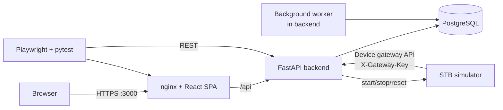

# BELL STB Device Management Portal

A production-style **set-top box (STB) fleet management portal** with a FastAPI backend, React/MUI
frontend, PostgreSQL, a separate **STB device simulator**, and a complete **Playwright (Python)
automation framework**.

> **Disclaimer** – This is a portfolio / test-automation environment inspired by telecom device
> management consoles. It is **not** an official Bell Canada system and uses no Bell logos or real
> customer data. All 500+ devices, telemetry, commands and firmware rollouts are **simulated**.


## Contents

- [Architecture](#architecture)
- [Quick start](#quick-start)
- [Demo accounts](#demo-accounts)
- [Modules](#modules)
- [API](#api)
- [Device simulator](#device-simulator)
- [Testing](#testing)
- [CI/CD](#cicd)
- [Project structure](#project-structure)

## Architecture



* **Frontend** – React 18, TypeScript, Vite, MUI, React Router, TanStack Query, Recharts, Axios.
* **Backend** – FastAPI, Pydantic v2, SQLAlchemy 2, Alembic, JWT auth (PyJWT) with bcrypt password hashing,
  role-based permissions enforced on every endpoint, append-only audit trail.
* **Database** – PostgreSQL 16 with migrations, indexes, FKs and an immutability trigger on `audit_logs`.
* **Simulator** – standalone Python service that behaves like a fleet of STBs and talks to the portal only
  through the **device gateway API** – the same contract a real ACS/USP integration service would use.
* **Telemetry storage strategy** – hot state in `device_status` (1 row/device); raw samples in
  `device_telemetry` with short retention (default 24h); hourly roll-ups in `device_telemetry_hourly`
  for history; hourly `fleet_snapshots` for availability analytics.

More detail: [docs/architecture.md](docs/architecture.md).

## Quick start

### Live demo on GitHub Pages

**https://dhikshanandhini03.github.io/device-management-portal/**

The static GitHub Pages build (`.github/workflows/pages.yml`) runs the portal UI with an in-browser demo backend
(`frontend/src/demo/`): the same API contract, RBAC, seed data, command lifecycle, firmware rollouts and device
simulator, persisted in your browser's `localStorage`. Sign in with the demo accounts below; use
*Reset demo data* on the login page to start fresh. UI automation can target this URL; API/gateway tests and
cross-user scenarios need the full stack (Codespaces or Docker) because each browser keeps its own data.

### Open in the browser (GitHub Codespaces – no local install)

[](https://codespaces.new/dhikshanandhini03/device-management-portal?quickstart=1)

The codespace starts the full stack automatically (first start takes a few minutes) and opens the
**Portal UI** (forwarded port 3000) in a new tab. Find the URL anytime in the **Ports** panel.
To share it, right-click port 3000 → *Port Visibility* → *Public*. Stop the codespace when done to
save your free Codespaces hours.

### Run locally

Prerequisites: Docker Desktop (or Docker Engine + Compose v2).

```bash
git clone https://github.com/dhikshanandhini03/device-management-portal.git
cd device-management-portal
cp .env.example .env            # optional – defaults work for local development
docker compose up -d --build --wait
```

| Service | URL |
|---|---|
| Portal UI | http://localhost:3000 |
| API docs (Swagger) | http://localhost:3000/api/docs (also http://localhost:8010/api/docs) |
| PostgreSQL | localhost:5433 (`bellstb` / see `.env.example`) |

On first start the backend runs `alembic upgrade head` and seeds roles, demo users, firmware,
applications and **500 simulated STBs** with 7 days of telemetry, events, logs, alerts, command and
deployment history. Data persists in the `pgdata` volume across restarts.

```bash
docker compose ps                  # health of db, backend, simulator, frontend
docker compose logs -f backend     # backend + worker logs
docker compose down                # stop (data kept)
docker compose down -v             # stop and delete the database volume
```

## Demo accounts

Development-only seed credentials (override with `SEED_*_PASSWORD` in `.env`):

| Role | Username | Password | Access |
|---|---|---|---|
| Administrator | `admin` | `Admin@12345` | Everything: users, firmware deployments, factory reset, audit logs, settings, simulator control |
| Support Engineer | `support` | `Support@12345` | Devices, diagnostics, remote commands (no factory reset), alert handling |
| Read Only | `readonly` | `Readonly@12345` | View dashboards, inventory, device details, reports |

Additional seeded users: `m.gagnon`, `d.okafor`, `p.nguyen`, `j.tremblay` (deactivated).

## Modules

| Module | Highlights |
|---|---|
| Dashboard | Fleet KPIs, online/offline, registration trend, firmware & model distribution, health, events, recent alerts/connections/admin activity |
| Device Inventory | Search (serial/MAC/ID/account/IP), filters, sorting, pagination, CSV export, device registration (admin) |
| Device Details | Overview, Network, Software, Hardware (telemetry charts), Activity, Logs, Remote Actions tabs |
| Device Management | Remote commands with confirmation, RBAC, staged lifecycle `PENDING → QUEUED → SENT → ACKNOWLEDGED → EXECUTING → SUCCESSFUL/FAILED/TIMED_OUT`, command history |
| Firmware | Inventory, distribution, deployments with target selection, scheduling, offline policy, live progress, cancel, rollback |
| Applications | Installed app inventory, version spread, update availability, per-version installations |
| Monitoring & Diagnostics | Fleet utilisation, health history, network status, top devices, filterable diagnostic logs, per-device health checks |
| Alerts | Severity/status/category filters, acknowledge/resolve with notes, history, auto-resolution |
| Analytics | Date-ranged availability, registrations, firmware/model distribution, uptime, failures, app usage, activity; CSV exports |
| User Management | Create/edit, role assignment, activate/deactivate, login history, user activity (admin only) |
| Audit Logs | Immutable event log with filters and export (admin only) |
| Settings | Profile/password, alert thresholds, simulator start/stop/reset |

## API

Interactive OpenAPI docs at `/api/docs`. Main groups:

```
/api/auth            login, logout, me, change-password
/api/dashboard       summary, charts, activity
/api/devices         list/filter/sort/export, CRUD, {id}/network|software|applications|telemetry|events|logs|commands|alerts
/api/commands        create (RBAC + confirmation), list, detail with stage history
/api/firmware        inventory, distribution, eligible-devices, deployments (+targets, cancel, rollback)
/api/applications    inventory, detail, installations
/api/monitoring      overview, health-history, top-devices, logs (+export), devices/{id}/diagnostics
/api/alerts          list, summary, export, acknowledge, resolve
/api/analytics       report, export
/api/users           CRUD, roles, activate/deactivate, login-history, activity
/api/audit-logs      list, actions, export (read-only; PUT/PATCH/DELETE -> 405)
/api/settings        system thresholds
/api/simulator       status/start/stop/reset (proxied to the simulator)
/api/gateway         device integration API (X-Gateway-Key) - heartbeats, events, command & firmware delivery
```

## Device simulator

`simulator/` runs as its own container (control API on port 8100, proxied via `/api/simulator/*`).
It loads the fleet from the gateway and simulates heartbeats, online/offline transitions, CPU/memory
random walks with load spikes, Wi-Fi signal drift, app crashes, critical errors, log lines, new device
registrations, remote command execution (with realistic stage delays, reboots and reconnection) and
firmware installation (download → install → reboot).

Device `simulation_profile` controls behaviour: `STANDARD` (random), `STABLE_ONLINE` / `STABLE_OFFLINE`
(deterministic lab devices used by automation). Commands accept a documented simulation hint
`parameters.simulate_outcome` = `FAILURE` | `NO_RESPONSE` for negative-path testing.

To integrate real devices, replace the simulator with a service that implements the same gateway contract
(`backend/app/api/routes/gateway.py`, `simulator/stb_simulator/gateway.py`).

## Testing

The automation framework lives in [`automation/`](automation/README.md) (Playwright for Python + pytest,
Page Object Model, API tests, end-to-end workflows, HTML + Allure reports, traces and screenshots).

```bash
cd automation
python -m venv .venv && . .venv/bin/activate     # Windows: .venv\Scripts\activate
pip install -r requirements.txt
python -m playwright install --with-deps chromium firefox webkit
pytest -n 4                       # full suite, chromium headless
pytest -m smoke
pytest -m end_to_end --headed
pytest --browser firefox
```

Reports: `automation/reports/report.html`, `automation/reports/allure-results` (`allure serve ...`),
traces in `automation/reports/test-results`.

**Nightly E2E (Jenkins):** [nightly-e2e/](nightly-e2e/README.md) is a separate Playwright for Python suite of
end-to-end business workflows against the GitHub Pages demo, run nightly by
[nightly-e2e/Jenkinsfile](nightly-e2e/Jenkinsfile).

## CI/CD

`.github/workflows/ci.yml` builds the frontend, import-checks backend and simulator, starts the full stack
with Docker Compose, runs the Playwright/API suite and uploads HTML/Allure reports, traces, screenshots and
logs as build artifacts. Trigger it manually (`workflow_dispatch`) to pick a browser or marker expression.

## Project structure

```
├── backend/          FastAPI app (api/routes, core, models, schemas, services, workers), Alembic, seed
├── frontend/         React + TypeScript SPA (pages, components, api, auth), nginx config
├── simulator/        STB fleet simulator (engine, device model, gateway client, control API)
├── automation/       Playwright Python framework (pages, tests, fixtures, api, utils, test_data)
├── database/         Database notes and schema overview
├── infrastructure/   Deployment notes
├── docs/             Architecture documentation
├── docker-compose.yml
└── .env.example
```
