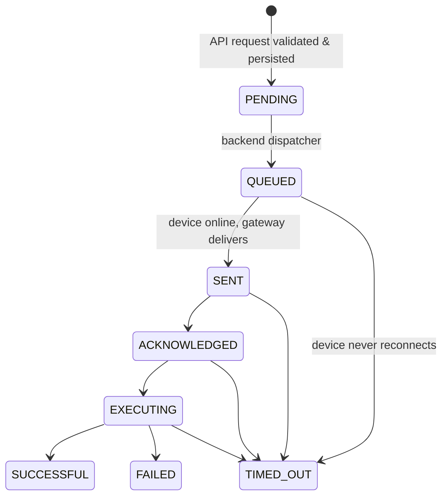
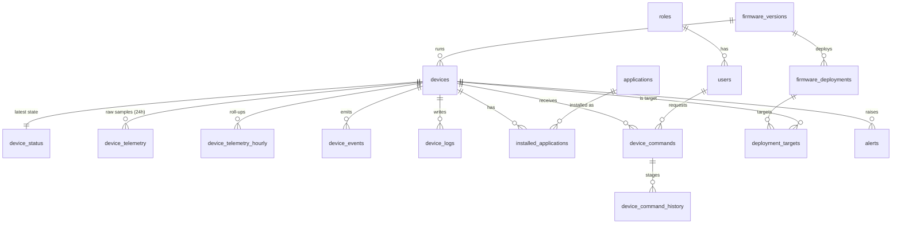

# Architecture

## Components

| Component | Tech | Responsibility |
|---|---|---|
| `frontend` | React 18, TypeScript, Vite, MUI, TanStack Query, Recharts, served by nginx | SPA; proxies `/api` to the backend |
| `backend` | FastAPI, SQLAlchemy 2, Alembic, Pydantic v2 | REST API, RBAC, audit, background worker |
| `db` | PostgreSQL 16 | System of record |
| `simulator` | Python asyncio + FastAPI control API | Simulated STB fleet using the device gateway API |

## Security

* JWT bearer tokens (HS256, 60 min default) signed with `JWT_SECRET`; bcrypt password hashes.
* Permissions are enforced server-side through `require(Permission.X)` dependencies; the UI only mirrors them.
  Denied requests are written to the audit log as `ACCESS_DENIED`.
* Login throttling: 10 failed attempts per username+IP within 5 minutes returns HTTP 429.
* The device gateway uses a separate shared key (`X-Gateway-Key`), never user tokens.
* `audit_logs` has a PostgreSQL trigger that rejects `UPDATE`/`DELETE`; the API exposes no mutation routes.
* CSV exports neutralise spreadsheet formula injection; LIKE searches escape wildcards.

## Role permissions

| Permission | ADMIN | SUPPORT_ENGINEER | READ_ONLY |
|---|:-:|:-:|:-:|
| View dashboard, devices, firmware, apps, monitoring, alerts, analytics, command history | ✔ | ✔ | ✔ |
| Execute remote commands | ✔ | ✔ | |
| Factory reset | ✔ | | |
| Acknowledge / resolve alerts | ✔ | ✔ | |
| Register/decommission devices, firmware deployments | ✔ | | |
| User management, audit logs, settings, simulator control | ✔ | | |

## Remote command lifecycle

Every transition is stored in `device_command_history`; terminal states also create a device event.
The API never reports success at creation time.

## Firmware deployments

`SCHEDULED → IN_PROGRESS → COMPLETED | COMPLETED_WITH_ERRORS | FAILED | CANCELLED | ROLLED_BACK`.
Targets move `PENDING → DOWNLOADING → INSTALLING → SUCCESS | FAILED`. Offline policy `WAIT` keeps offline
targets pending until the deployment window (`deployment_target_timeout_seconds`) closes; `SKIP` fails
them at start. Rollback creates a new deployment that reinstalls each device's previous firmware.

## Data model

Other tables: `audit_logs` (append-only), `system_settings`, `fleet_snapshots`.

## Telemetry ingestion & retention

1. The gateway updates `device_status` on every heartbeat (hot path, one row per device).
2. Every ~60s per device a raw sample goes to `device_telemetry`.
3. The backend worker rolls raw samples into `device_telemetry_hourly` (upsert) and deletes raw rows older than
   `telemetry_raw_retention_hours`.
4. Hourly `fleet_snapshots` capture online/offline/health counts for availability analytics.

For larger fleets the raw table can be converted to native range partitioning (daily partitions dropped
instead of deleted) or moved to TimescaleDB without API changes.

## Background worker

Runs inside the backend process (single uvicorn worker): dispatches `PENDING` commands, times out stale
commands, starts scheduled deployments, fails unreachable targets, finalises deployments, rolls up
telemetry and captures fleet snapshots.
